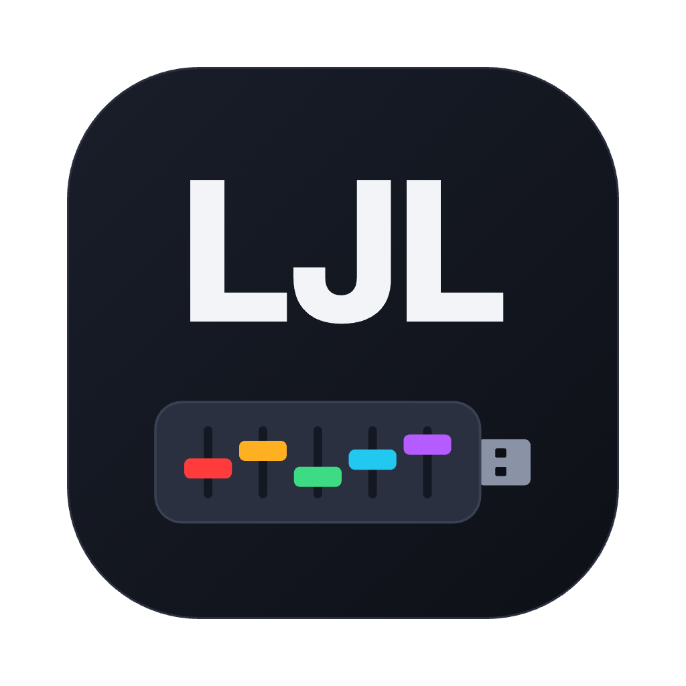
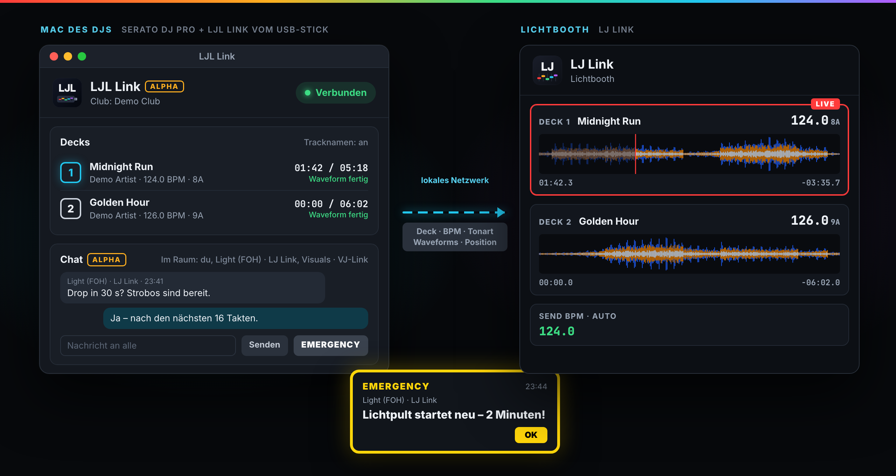
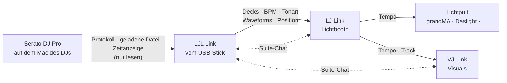

<p align="center">
  
</p>

<h1 align="center">LJL Link</h1>

<p align="center"><b>LJ LAN Link</b></p>

<p align="center">
  <b>Deine Serato-Decks in der Lichtbooth.</b><br>
  Direkt vom USB-Stick des Clubs zu LJ Link – nichts installieren.
</p>

<p align="center">
  <a href="https://skyplayser.github.io/Link-Suite/"></a>
</p>

<p align="center">
  <a href="https://github.com/skyplayser/LJL-Link/releases"></a>
  <a href="https://github.com/skyplayser/LJL-Link/releases"></a>
  
  
  <a href="LICENSE"></a>
</p>

<p align="center">
  <a href="https://skyplayser.github.io/LJL-Link/de/">Website</a> &nbsp;·&nbsp;
  <a href="#schnellstart">Schnellstart</a> &nbsp;·&nbsp;
  <a href="https://skyplayser.github.io/LJ-Link/de/wiki-serato.html#ljl-link">Anleitung (LJ-Link-Wiki)</a> &nbsp;·&nbsp;
  <a href="https://discord.gg/N6DMca4Bjk">Discord</a> &nbsp;·&nbsp;
  <a href="https://github.com/skyplayser/LJ-Link">LJ Link</a> &nbsp;·&nbsp;
  <a href="README.md">English</a>
</p>

<p align="center">
  
  <br><sub>Illustration mit Demo-Tracks. EMERGENCY ist keine Sicherheitstechnik.</sub>
</p>

Serato DJ Pro bietet keine öffentliche Schnittstelle, über die LJ Link Decks, Waveforms und Position bekommen könnte – die Lichtbooth weiß deshalb meist nicht, was als Nächstes kommt.
**LJL Link – der LJ LAN Link – schließt diese Lücke.** Die kleine Mac-App läuft vom USB-Stick des Clubs und schickt der Booth, was auf deinen Decks
liegt: welcher Track auf welchem Deck, Länge, BPM und Tonart, Waveforms in drei Bändern und die laufende Position. In der Booth
zeigt [LJ Link](https://github.com/skyplayser/LJ-Link) deine Decks neben allen anderen Playern – so treffen Licht und Effekte die
Drops und Breaks.

LJL Link liest auf deinem Mac mit – **passiv**: Es steuert Serato nicht und fasst Controller und MIDI nicht an.

> [!WARNING]
> **Das ist eine Alpha.** LJL Link ist lokal getestet, aber noch nicht im Club-Einsatz. Probier es vor einem wichtigen Abend
> aus und erzähl uns, was du findest: **Fehler melden** im Programm oder auf [Discord](https://discord.gg/N6DMca4Bjk).

## Highlights

<table>
<tr>
<td width="50%" valign="top">

**🔌 Läuft vom USB-Stick**<br>
Der Club legt LJL Link auf seinen Stick. Einstecken, App starten – installiert wird nichts. Am Ende *Beenden* (⌘Q) und den Stick
abziehen; Fenster schließen reicht nicht, LJL Link sendet sonst aus der Menüleiste weiter.

</td>
<td width="50%" valign="top">

**🎛️ Deine Decks in der Booth**<br>
Welcher Track auf welchem Deck liegt, mit Länge, BPM und Tonart – neben allen anderen Playern in LJ Link.

</td>
</tr>
<tr>
<td valign="top">

**🌊 Waveforms in drei Bändern**<br>
Tiefen, Mitten und Höhen getrennt, als Übersicht über den ganzen Track und als Detail-Waveform. Berechnet auf deinem Mac aus der
geladenen Datei; der Ton selbst verlässt ihn nie.

</td>
<td valign="top">

**⏱️ Laufende Position**<br>
Gelesen aus der Zeitanzeige im Serato-Fenster, damit die Waveform in LJ Link mit deinem Track mitläuft.

</td>
</tr>
<tr>
<td valign="top">

**🔒 Du entscheidest über die Namen**<br>
Beim Start fragt LJL Link, ob Tracknamen gesendet werden dürfen, und du kannst es jederzeit umschalten. Ohne dein OK verlassen
Titel, Artists und Dateinamen deinen Mac nicht.

</td>
<td valign="top">

**🛡️ Passiv**<br>
LJL Link liest nur Seratos Logdatei, den geladenen Track (für Waveform, BPM und Tonart) und die Zeitanzeige. Keine Steuerung,
kein MIDI, kein Plug-in.

</td>
</tr>
<tr>
<td valign="top">

**📡 Findet die Booth**<br>
Die `club.json` neben der App enthält die Adresse der Booth und den Club-Schlüssel. Hat der Booth-Rechner eine neue Adresse,
findet LJL Link LJ Link per Bonjour im lokalen Netzwerk; der Schlüssel entscheidet.

</td>
<td valign="top">

**💬 Suite-Chat mit EMERGENCY**<br>
Ein Chatraum mit allen Suite-Programmen im Netzwerk – LJ Link, VJ-Link, LJL Link – ohne Server. Der **EMERGENCY**-Knopf öffnet
bei allen ein Popup unten rechts. Abschaltbar; Nachrichten werden nie gespeichert und stehen nie im Log.

</td>
</tr>
<tr>
<td valign="top">

**👋 Einfach für jeden DJ**<br>
Ein Willkommensbildschirm erklärt alles vor der ersten Frage, das Symbol in der Menüleiste zeigt, ob alles läuft, und die App
spricht **Deutsch und Englisch** (nach der Sprache des Macs).

</td>
<td valign="top">

**🩺 Fehler melden, eingebaut**<br>
*Fehler melden* erstellt einen Bericht, den du vor dem Senden siehst – mit Diagnosedaten, aber ohne Tracktitel, Dateinamen und
Club-Schlüssel.

</td>
</tr>
</table>

## So funktioniert's



Alles bleibt im lokalen Netzwerk: kein Konto, keine Cloud, keine Telemetrie, keine Verbindung ins Internet.

## Was deinen Mac verlässt

LJL Link sendet nur im lokalen Netzwerk: an LJ Link im Club und, solange er an ist, an den Suite-Chat. Kein Konto, keine Cloud,
keine Telemetrie, keine Verbindung ins Internet.

| Daten | An LJ Link |
|---|---|
| Name des Macs (aus den Systemeinstellungen), Version von LJL Link | ja – LJ Link zeigt damit, von wem die Decks kommen |
| Deck-Nummer, Länge, BPM, Tonart | ja |
| Waveforms (drei Bänder) | ja |
| Laufende Position | ja, wenn *Bildschirmaufnahme* erlaubt ist – nur die Zeit, kein Bild |
| Titel und Artist | nur, wenn du es erlaubst |
| Dateinamen, Ordner, der Ton selbst | nie |
| Chat-Nachrichten | an alle Suite-Programme im Netzwerk, solange der Chat an ist |

Jeder geladene Track bekommt eine zufällige Kennung; der Dateipfad wird nie gesendet. Das Protokoll steht in
[docs/protocol.md](docs/protocol.md) (Englisch).

## Voraussetzungen

| Was | Stand |
|---|---|
| Mac mit macOS 14 oder neuer, Apple silicon oder Intel (eine Universal-App) | Alpha; getestet auf einem Mac mit Apple silicon und aktuellem macOS, noch nicht auf Intel oder älterem macOS |
| Serato DJ Pro | Alpha, lokal getestet, noch nicht im Club |
| [LJ Link](https://github.com/skyplayser/LJ-Link) in der Lichtbooth, ab Version 1.7.11 (sie hat den Eingang für LJL Link) | Alpha |
| Mac und Booth im selben lokalen Netzwerk | nötig |
| *Stick vorbereiten* in LJ Link (schreibt LJL Link und `club.json` auf den Stick) | geplant; bis dahin `club.json` von Hand |
| Windows, andere DJ-Software | nicht unterstützt |

## Installieren

> **Neu: Installieren und Aktualisieren über den [Link-Suite Launcher](https://skyplayser.github.io/Link-Suite/).** Launcher laden ([macOS Apple-Chip](https://github.com/skyplayser/Link-Suite/releases/latest/download/Link-Suite-macos-arm64.dmg) · [macOS Intel](https://github.com/skyplayser/Link-Suite/releases/latest/download/Link-Suite-macos-intel.dmg)), öffnen und bei LJL Link auf *Installieren* klicken. Der Launcher lädt LJL Link direkt aus den Releases dieses Repos, prüft die Datei und hält LJL Link und alle anderen Programme der Link-Suite aktuell.

LJL Link mit dem Link-Suite Launcher laden (*Für den Stick laden …*) und zusammen mit der
`club.json` des Clubs auf den USB-Stick legen (siehe unten).

Die App ist **ad-hoc signiert, aber noch nicht bei Apple notarisiert**. Deshalb blockiert macOS eine aus dem Internet geladene
Kopie beim ersten Start einmal („LJL Link“ nicht geöffnet):

- LJL Link einmal starten und bei der Warnung auf *Fertig* klicken. *Systemeinstellungen → Datenschutz & Sicherheit* öffnen,
  nach unten scrollen, bei LJL Link auf **Dennoch öffnen** klicken, mit Passwort oder Touch ID bestätigen, dann *Öffnen*.
- Auf macOS 14 geht auch: Rechtsklick auf die App → *Öffnen* → *Öffnen*.
- Per Terminal: `xattr -dr com.apple.quarantine "LJL Link.app"` (mit dem Pfad zur App). Das schaltet die Download-Prüfung von
  macOS für diese App ab – nur für eine Kopie von dieser GitHub-Seite oder der offiziellen Website verwenden.

Sobald LJ Link den Stick vorbereitet (die Funktion kommt noch), trägt die App keine Download-Markierung und startet ohne Warnung.

Beim ersten Start stellt macOS zwei Fragen:

- **Lokales Netzwerk:** *Erlauben*. Damit findet LJL Link LJ Link in der Booth, und der Chat funktioniert.
- **Bildschirmaufnahme:** in den Systemeinstellungen für LJL Link einschalten. LJL Link nutzt sie nur, um die Zeitanzeige im
  Serato-Fenster zu lesen (Einzelheiten in der [Datenschutzerklärung](https://skyplayser.github.io/LJL-Link/datenschutz.html)); nichts wird gespeichert oder gesendet außer der Zeit. Ohne die Erlaubnis läuft alles, nur ohne mitlaufende Position.

## Schnellstart

1. **Stick vom Club:** Die Lichttechnik legt LJL Link und die `club.json` auf einen USB-Stick. Der Mac des DJs muss im selben
   Netzwerk sein wie LJ Link.
2. **Starten:** Stick einstecken, LJL Link starten, *Lokales Netzwerk* und *Bildschirmaufnahme* erlauben und die Frage nach den
   Tracknamen beantworten.
3. **Auflegen:** Tracks in Serato laden wie immer. Deine Decks erscheinen in LJ Link. Am Ende *Beenden* (⌘Q), dann den Stick
   abziehen.

Die ausführliche Anleitung steht im LJ-Link-Wiki: **[Serato DJ Pro](https://skyplayser.github.io/LJ-Link/de/wiki-serato.html#ljl-link)**
und [Anwendungsfall: Serato auf dem DJ-Laptop](https://skyplayser.github.io/LJ-Link/de/wiki-case-serato.html). LJL Link hat kein
eigenes Wiki.

### club.json

LJL Link sucht die `club.json` neben der App. Liegt keine dort, kannst du die Datei in der App auswählen. LJ Link schreibt sie,
wenn es den Stick vorbereitet; bis diese Funktion erscheint, wird sie von Hand angelegt, wie es die Anleitung im LJ-Link-Wiki
beschreibt. Das Format:

```json
{
  "version": 1,
  "club": "<Name, den der DJ sieht>",
  "hosts": ["<Adresse des Booth-Rechners>"],
  "port": <Port von LJ Link>,
  "key": "<Club-Schlüssel aus LJ Link>"
}
```

Der Club-Schlüssel ist kein Passwort einer Person. Ein neuer Schlüssel in LJ Link macht jede ältere `club.json` ungültig; LJL Link
sagt dann, dass der Stick neu vorbereitet werden muss.

## Suite-Chat

LJL Link, [LJ Link](https://github.com/skyplayser/LJ-Link) und [VJ-Link](https://github.com/skyplayser/VJ-LINK) im selben
Netzwerk teilen sich einen Chatraum, ohne Server – so können DJ und Booth sich schreiben, statt über die Tanzfläche zu rufen.
Nachrichten liegen nur im Arbeitsspeicher und landen nie in einer Datei, im Protokoll oder in einem Fehlerbericht. Der Chat ist **nicht
verschlüsselt**: Wer im selben Netzwerk ist, kann mitlesen (mit einem Suite-Programm oder einem Netzwerkwerkzeug) – schreib also
nichts Vertrauliches hinein –, und die anderen Programme geben Neuen die letzten bis zu 20 Nachrichten je Programm weiter.
Mehr in der [Datenschutzerklärung](https://skyplayser.github.io/LJL-Link/datenschutz.html). Der Chat ist eine Alpha und
lässt sich in der App abschalten; getestet auf einem Mac mit LJ Link, LJL Link und VJ-Link, noch nicht zwischen zwei Rechnern
und nicht im Club. Spezifikation:
[docs/suite-chat.md bei LJ Link](https://github.com/skyplayser/LJ-Link/blob/main/docs/suite-chat.md) (Englisch).

> [!IMPORTANT]
> EMERGENCY ist ein Hinweis-Popup im Team, keine Alarm- oder Sicherheitstechnik. Es ist eine Alpha, kann ausfallen oder zu spät ankommen und von jedem im selben Netzwerk ausgelöst werden. Es ersetzt keine Durchsage, keinen Funk und kein Sicherheitskonzept der Veranstaltung.

## Probleme?

Nutze **Fehler melden** in der App: beschreib, was passiert, und lass *Diagnosedaten anhängen* angehakt. Die Diagnosedaten
enthalten die Versionen von LJL Link, macOS und Serato, die Verbindung zu LJ Link, den Zustand der Decks (Länge, Position,
Waveform) und die letzten Protokollzeilen – keine Tracktitel, keine Artists, keine Dateinamen, keinen Club-Schlüssel – und du
siehst sie vor dem Senden. Schick den Bericht per E-Mail (dein Mailprogramm öffnet eine Mail an fehlermelden@nextphilm.de),
sichere ihn als Datei oder kopiere ihn.

## Selbst bauen

LJL Link ist ein Swift-Paket in `sender/` (macOS 14, Swift 5.9; die Command Line Tools reichen).

```sh
cd sender
swift run -c release selftest   # Selbsttest ohne XCTest
./build-app.sh                  # baut „LJL Link.app“ (Apple silicon und Intel), ad-hoc signiert, in .build/app
```

| Ordner | Inhalt |
|---|---|
| `sender/Sources/SenderCore` | alles Testbare: Serato-Protokoll, Track-Tags, Waveforms, Zeitanzeige, Club-Konfiguration, Protokoll zu LJ Link, Suite-Chat |
| `sender/Sources/LJLLinkApp` | die App: Willkommen, Frage nach den Tracknamen, Decks, Chat, Fehlerbericht, Menüleiste |
| `sender/Sources/ljlink-sender` | Kommandozeile für die Entwicklung |
| `sender/Sources/selftest` | der Selbsttest |
| `docs/protocol.md` | das Protokoll zwischen LJL Link und LJ Link (Englisch) |

## Die Suite

<a href="https://github.com/skyplayser/LJ-Link"></a>

**[LJ Link](https://github.com/skyplayser/LJ-Link)** zeigt dem Lichtjockey, was der DJ spielt: jedes Deck, jede Waveform, jeden
Cue und das BPM von Pioneer- und Denon-Geräten – und mit LJL Link auch von Serato – und schickt das Tempo an grandMA, Daslight und
mehr. LJL Link braucht es in der Booth. Kostenlos für macOS und Windows.

<br clear="left">

<a href="https://github.com/skyplayser/VJ-LINK"></a>

**[VJ-Link](https://github.com/skyplayser/VJ-LINK)** spielt Live-Visuals, gesteuert vom Lichtpult, auf Bildschirmen, LED-Wänden
und Beamern und holt sich Tempo und Track aus LJ Link. Kostenlos für macOS und Windows.

<br clear="left">

## Danksagung und Hinweise

Logo-Schrift: [Inter](https://github.com/rsms/inter) (SIL Open Font License 1.1, siehe [docs/Inter-OFL.txt](docs/Inter-OFL.txt)).
Die PNGs enthalten keine Schriftsoftware.

LJL Link ist ein unabhängiges Projekt für Nutzer von Serato DJ Pro und ist nicht mit Serato verbunden. Es ist kein offizielles Produkt eines Herstellers
von DJ-, Licht- oder Musik-Hardware oder -Software und wird von keinem dieser Hersteller unterstützt oder geprüft – auch nicht von
Serato. Alle in LJL Link und seiner Dokumentation genannten Produktnamen und Marken gehören ihren jeweiligen Inhabern und werden
nur genannt, um die Kompatibilität zu beschreiben. Serato und Serato DJ Pro sind Marken von Serato. LJL Link hat nichts mit der
Software LightJockey von Martin zu tun.

LJL Link ist kostenlos und ohne Gewähr. Software, Netzwerk und Geräte können ausfallen: Die Lichttechnik sollte immer einen
Ausweg bereithalten, zum Beispiel Tap-Tempo am Pult.

## Lizenz

© 2026 Philipp Spruck / NEXTPHILM. LJL Link steht unter der [Eclipse Public License 2.0](LICENSE), ohne jede Gewährleistung.

<br>

<p align="center">
  <sub>Idee SKYPLAYSER/NEXTPHILM<br>
  Prompted with ❤️ made by Claude<br>
  <a href="https://skyplayser.github.io/LJL-Link/impressum.html">Impressum</a> ·
  <a href="https://skyplayser.github.io/LJL-Link/datenschutz.html">Datenschutz</a></sub>
</p>
