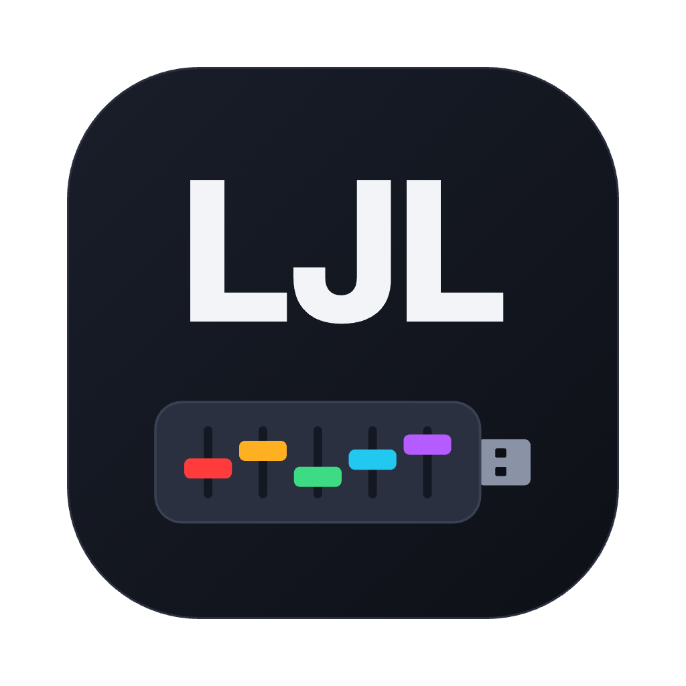
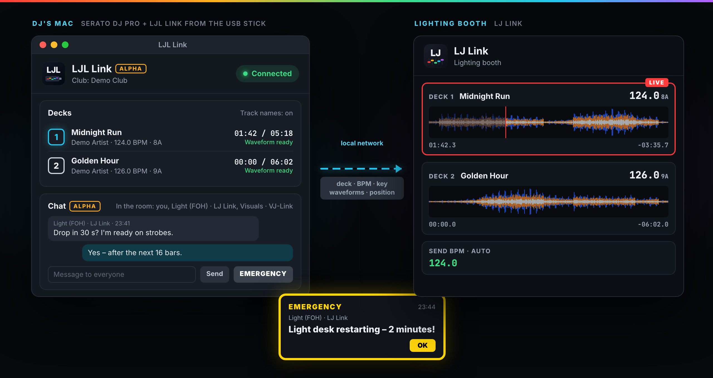
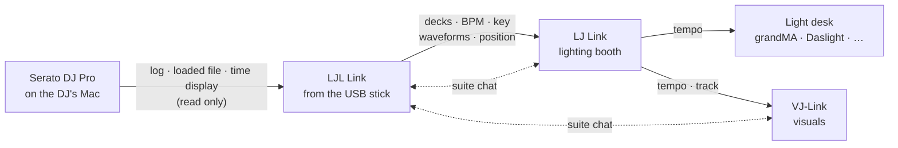

<p align="center">
  
</p>

<h1 align="center">LJL Link</h1>

<p align="center">
  <b>Your Serato decks in the lighting booth.</b><br>
  Straight from the club's USB stick to LJ Link – nothing to install.
</p>

<p align="center">
  <a href="https://github.com/skyplayser/LJL-Link/releases/latest"></a>
</p>

<p align="center">
  <a href="https://github.com/skyplayser/LJL-Link/releases"></a>
  
  
  <a href="LICENSE"></a>
</p>

<p align="center">
  <a href="https://skyplayser.github.io/LJL-Link/">Website</a> &nbsp;·&nbsp;
  <a href="#quick-start">Quick start</a> &nbsp;·&nbsp;
  <a href="https://skyplayser.github.io/LJ-Link/wiki-serato.html#ljl-link">Guide (LJ Link wiki)</a> &nbsp;·&nbsp;
  <a href="https://discord.gg/N6DMca4Bjk">Discord</a> &nbsp;·&nbsp;
  <a href="https://github.com/skyplayser/LJ-Link">LJ Link</a> &nbsp;·&nbsp;
  <a href="README.de.md">Deutsch</a>
</p>

<p align="center">
  
  <br><sub>Illustration with demo tracks. EMERGENCY is not a safety system.</sub>
</p>

Serato DJ Pro has no public interface that LJ Link could use for decks, waveforms and position – so the lighting booth usually has no idea what is coming next.
**LJL Link closes that gap.** It is a small Mac app that runs from the club's USB stick and sends the booth what is on your decks:
which track is on which deck, its length, BPM and key, three-band waveforms and the running position. In the booth,
[LJ Link](https://github.com/skyplayser/LJ-Link) shows your decks next to every other player, so lights and effects hit the drops
and breaks.

It follows along on your Mac – **passively**: it never controls Serato and never touches controllers or MIDI.

> [!WARNING]
> **This is an alpha.** LJL Link has been tested locally, but not yet in a club. Try it before an important night, and tell
> us what you find: **Report a problem** in the app, or on [Discord](https://discord.gg/N6DMca4Bjk).

## Highlights

<table>
<tr>
<td width="50%" valign="top">

**🔌 Runs from the USB stick**<br>
The club puts LJL Link on its stick. Plug it in, start the app – nothing is installed. At the end choose *Quit* (⌘Q) and unplug
the stick; closing the window is not enough, LJL Link keeps sending from the menu bar.

</td>
<td width="50%" valign="top">

**🎛️ Your decks in the booth**<br>
Which track is on which deck, with length, BPM and key – next to every other player in LJ Link.

</td>
</tr>
<tr>
<td valign="top">

**🌊 Three-band waveforms**<br>
Lows, mids and highs apart, as an overview of the whole track and as a detail waveform. Built on your Mac from the loaded file;
the audio itself never leaves it.

</td>
<td valign="top">

**⏱️ Running position**<br>
Read from the time display in Serato's window, so the waveform in LJ Link runs along with your track.

</td>
</tr>
<tr>
<td valign="top">

**🔒 You decide about names**<br>
At the start LJL Link asks whether track names may be sent, and you can switch it any time. Without your OK, titles, artists and
file names do not leave your Mac.

</td>
<td valign="top">

**🛡️ Passive**<br>
LJL Link only reads Serato's log file, the loaded track (for waveform, BPM and key) and the time display. No control, no MIDI, no
plug-in.

</td>
</tr>
<tr>
<td valign="top">

**📡 Finds the booth**<br>
`club.json` next to the app holds the booth address and the club key. If the booth computer has a new address, LJL Link finds
LJ Link with Bonjour in the local network; the key decides.

</td>
<td valign="top">

**💬 Suite chat with EMERGENCY**<br>
One chat room with every suite program in the network – LJ Link, VJ-Link, LJL Link – without a server. The **EMERGENCY** button
opens a pop-up at the bottom right for everyone. Can be switched off; messages are never saved and never logged.

</td>
</tr>
<tr>
<td valign="top">

**👋 Simple for every DJ**<br>
A welcome screen explains everything before the first question, the menu bar icon shows whether all is well, and the app speaks
**English and German** (after the Mac's language).

</td>
<td valign="top">

**🩺 Report a problem, built in**<br>
*Report a problem* creates a report you see before sending – with diagnostic data, but without track titles, file names or the club key.

</td>
</tr>
</table>

## How it works



Everything stays in the local network: no account, no cloud, no telemetry, no internet connection.

## What leaves your Mac

LJL Link sends only within the local network: to LJ Link in the club and, while it is on, to the suite chat. It has no account,
no cloud, no telemetry and opens no connection to the internet.

| Data | To LJ Link |
|---|---|
| Name of the Mac (from System Settings), LJL Link version | yes – LJ Link shows with it whose decks these are |
| Deck number, length, BPM, key | yes |
| Waveforms (three bands) | yes |
| Running position | yes, if *Screen Recording* is allowed – only the time, no picture |
| Title and artist | only if you allow it |
| File names, folders, the audio itself | never |
| Chat messages | to every suite program in the network while the chat is on |

Each loaded track gets a random id; the file path is never sent. The protocol is described in [docs/protocol.md](docs/protocol.md).

## Requirements

| What | State |
|---|---|
| Mac with macOS 14 or newer, Apple silicon or Intel (one universal app) | alpha; tested on one Apple silicon Mac with the current macOS, not yet on Intel or older macOS |
| Serato DJ Pro | alpha, tested locally, not yet in a club |
| [LJ Link](https://github.com/skyplayser/LJ-Link) in the lighting booth, version 1.7.11 or newer (it has the input for LJL Link) | alpha |
| Mac and booth in the same local network | required |
| *Prepare stick* in LJ Link (writes LJL Link and `club.json` onto the stick) | planned; until then `club.json` by hand |
| Windows, other DJ software | not supported |

## Install

Download LJL Link from the [latest release](https://github.com/skyplayser/LJL-Link/releases/latest) and put it on the USB stick
together with the club's `club.json` (see below).

The app is **ad-hoc signed, but not notarized by Apple yet**. So macOS blocks a copy downloaded from the internet once on the
first start (“LJL Link” Not Opened):

- Start LJL Link once and click *Done* at the warning. Open *System Settings → Privacy & Security*, scroll down, click
  **Open Anyway** next to LJL Link and confirm with your password or Touch ID, then *Open*.
- On macOS 14, right-click the app → *Open* → *Open* also works.
- Terminal alternative: `xattr -dr com.apple.quarantine "LJL Link.app"` (with the path to the app). This switches off macOS's
  download check for this app, so only use it for a copy from this GitHub page or the official website.

Once LJ Link prepares the stick (the function is still to come), the app carries no download flag and starts without the warning.

On the first start macOS asks two questions:

- **Local Network:** *Allow*. With it LJL Link finds LJ Link in the booth, and the chat works.
- **Screen Recording:** switch it on for LJL Link in System Settings. LJL Link uses it only to read the time display in Serato's
  window (details in the [privacy policy](https://skyplayser.github.io/LJL-Link/datenschutz.html)); nothing is stored or sent except the time. Without it everything works, only without the running position.

## Quick start

1. **Stick from the club:** the lighting team puts LJL Link and `club.json` on a USB stick. The DJ's Mac has to be in the same
   network as LJ Link.
2. **Start:** plug in the stick, start LJL Link, allow *Local Network* and *Screen Recording* and answer the question about
   track names.
3. **Play:** load tracks in Serato as usual. Your decks appear in LJ Link. At the end choose *Quit* (⌘Q), then unplug the stick.

The full guide is in the LJ Link wiki: **[Serato DJ Pro](https://skyplayser.github.io/LJ-Link/wiki-serato.html#ljl-link)** and
[Use case: Serato on the DJ laptop](https://skyplayser.github.io/LJ-Link/wiki-case-serato.html). LJL Link has no wiki of its own.

### club.json

LJL Link looks for `club.json` next to the app. If there is none, you can choose the file in the app. LJ Link will write this file when it
prepares the stick; until that function is released, it is made by hand as the guide in the LJ Link wiki describes. The format:

```json
{
  "version": 1,
  "club": "<name shown to the DJ>",
  "hosts": ["<address of the booth computer>"],
  "port": <LJ Link's port>,
  "key": "<club key from LJ Link>"
}
```

The club key is not anyone's password. A new key in LJ Link makes every older `club.json` invalid; LJL Link then says the stick
has to be prepared again.

## Suite chat

LJL Link, [LJ Link](https://github.com/skyplayser/LJ-Link) and [VJ-Link](https://github.com/skyplayser/VJ-LINK) in the same
network share one chat room, without a server – so the DJ and the booth can write to each other instead of shouting across the
dance floor. Messages are kept only in memory, never written to a file, a log or a problem report. The chat is **not encrypted**:
anyone in the same network can read along (with a suite program or a network tool), so do not write anything confidential, and
the other programs pass the latest up to 20 messages per program on to newcomers. Details in the
[privacy policy](https://skyplayser.github.io/LJL-Link/datenschutz.html). The chat is an alpha and can be switched
off in the app; it was tested on one Mac with LJ Link, LJL Link and VJ-Link, not yet between two computers and not in a club. Specification: [docs/suite-chat.md in LJ Link](https://github.com/skyplayser/LJ-Link/blob/main/docs/suite-chat.md).

> [!IMPORTANT]
> EMERGENCY is a heads-up pop-up for the team, not an alarm or safety system. It is an alpha, can fail or arrive late, and anyone in the same network can trigger it. It does not replace announcements, radios or the event's safety plan.

## Problems?

Use **Report a problem** in the app: describe what happens and leave *Include diagnostic data* ticked. The diagnostic data holds
the versions of LJL Link, macOS and Serato, the connection to LJ Link, the state of the decks (length, position, waveform) and
the last log lines – no track titles, no artists, no file names, no club key – and you see it before sending. Send it by email
(your mail program opens a mail to fehlermelden@nextphilm.de), save it as a file or copy it.

## Build from source

LJL Link is a Swift package in `sender/` (macOS 14, Swift 5.9, the Command Line Tools are enough).

```sh
cd sender
swift run -c release selftest   # self test without XCTest
./build-app.sh                  # builds "LJL Link.app" (Apple silicon and Intel), ad-hoc signed, in .build/app
```

| Folder | What |
|---|---|
| `sender/Sources/SenderCore` | everything testable: Serato log, track tags, waveforms, time display, club config, protocol, suite chat |
| `sender/Sources/LJLLinkApp` | the app: welcome, track-name question, decks, chat, report, menu bar |
| `sender/Sources/ljlink-sender` | command line front end for development |
| `sender/Sources/selftest` | the self test |
| `docs/protocol.md` | the protocol between LJL Link and LJ Link |

## The suite

<a href="https://github.com/skyplayser/LJ-Link"></a>

**[LJ Link](https://github.com/skyplayser/LJ-Link)** shows the lighting jockey what the DJ plays: every deck, waveform, cue and
the BPM from Pioneer and Denon gear – and, with LJL Link, from Serato – and sends the tempo to grandMA, Daslight and more.
LJL Link needs it in the booth. Free for macOS and Windows.

<br clear="left">

<a href="https://github.com/skyplayser/VJ-LINK"></a>

**[VJ-Link](https://github.com/skyplayser/VJ-LINK)** plays live visuals run by the light desk, on screens, LED walls and
projectors, and takes tempo and track from LJ Link. Free for macOS and Windows.

<br clear="left">

## Credits and notices

Logo lettering: [Inter](https://github.com/rsms/inter) (SIL Open Font License 1.1, see [docs/Inter-OFL.txt](docs/Inter-OFL.txt)).
The PNGs contain no font software.

LJL Link is an independent project for use with Serato DJ Pro and is not affiliated with Serato. It is not an official product of, and is not endorsed by, any
maker of DJ, lighting or music hardware or software – including Serato. All product names and trademarks mentioned in LJL Link
and its documentation belong to their respective owners and are used only to describe compatibility. Serato and Serato DJ Pro are
trademarks of Serato. LJL Link is not related to the LightJockey software by Martin.

LJL Link is free and comes without warranty. Software, network and devices can fail: the lighting team should always keep a
fallback ready, for example tap tempo on the desk.

## License

© 2026 Philipp Spruck / NEXTPHILM. LJL Link is distributed under the [Eclipse Public License 2.0](LICENSE), without any warranty.

<br>

<p align="center">
  <sub>Idea SKYPLAYSER/NEXTPHILM<br>
  Prompted with ❤️ made by Claude<br>
  <a href="https://skyplayser.github.io/LJL-Link/impressum.html">Legal notice (Impressum)</a> ·
  <a href="https://skyplayser.github.io/LJL-Link/datenschutz.html">Privacy</a></sub>
</p>
